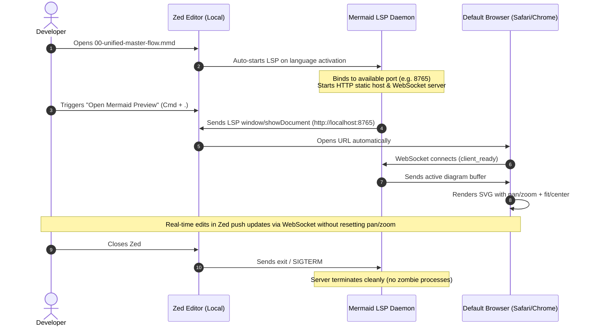

# Zed Mermaid Preview Extension: Specification & Feature-Driven Plan

## 1. Executive Summary & Goals

### Goal
Build a zero-configuration, high-fidelity Mermaid preview system for **Zed IDE** that:
1. **Provides 100% Diagram Fidelity:** Uses the official `mermaid.js` engine and WebKit/browser canvas (no partial reverse-engineered Rust parsers).
2. **Offers Interactive Navigation Controls:** Includes full pan, pinch-to-zoom, "Fit to Screen", "Center", "Reset 100%", theme matching, and SVG/PNG export.
3. **Requires Zero Configuration:** Starts silently in the background, grabs an open port automatically, launches the default browser via Zed LSP `window/showDocument`, and exits cleanly when Zed closes.
4. **Validates Syntax in Real Time:** Uses `mermaid.parse` to catch syntax errors and report them as diagnostics in Zed.
5. **Operates Local-First:** Designed and validated on macOS local first, while architecturally ready for remote SSH tunneling without code changes.

---

## 2. System Architecture & Flow

---

## 3. Feature-Driven Implementation Checklist

Instead of horizontal layers, this plan is structured into **vertical feature slices**. Each feature produces a testable, end-to-end capability.

### 🌟 Feature Slice 1: The Interactive Preview Canvas (Frontend)
> **Goal:** Create a standalone, high-performance web canvas that renders Mermaid diagrams with smooth controls, state-preserving viewport, and zero external dependencies.

- [ ] **1.1 Single-bundle Webview Shell (`src/webview/index.html`)**
  - Integrated `mermaid.js` (official runtime) and `svg-pan-zoom`.
  - Modern dark/light theme styling matching Zed's aesthetic.
- [ ] **1.2 Canvas Controls & Toolbar**
  - `[Fit to Screen]` button: scales any diagram to fit visible viewport.
  - `[Center]` button: recenters without changing zoom level.
  - `[Reset 100%]` button: restores 1:1 pixel ratio.
  - `[Export SVG]` / `[Export PNG]` buttons.
- [ ] **1.3 Viewport State Lock (No Flash / Jump)**
  - When new diagram content arrives, preserve current `(panX, panY, zoomScale)` so redrawing does not snap to the top-left.
- [ ] **1.4 Syntax Error Overlay**
  - When broken syntax is received, display a non-intrusive floating error pill with the line number while retaining the previous valid diagram.

---

### 🌟 Feature Slice 2: The Zero-Config Live Daemon & Validator (Backend)
> **Goal:** Build the headless daemon that serves the frontend, watches files/buffers, validates syntax, and streams updates over WebSockets.

- [ ] **2.1 Automatic Port Allocator**
  - Attempt default port `8765`; if busy, silently fall back to `8766`, `8767`, or ephemeral free port (`port: 0`).
- [ ] **2.2 Static Asset & WebSocket Server (`src/server/index.js`)**
  - Serves the frontend webview files.
  - Upgrades to WebSocket endpoint `/ws` for live diagram synchronization.
- [ ] **2.3 Official Syntax Validation (`mermaid.parse`)**
  - Run `mermaid.parse(code)` on every buffer update.
  - Return exact line, column, and error message to the editor if invalid.
- [ ] **2.4 Clean Process Lifecycle**
  - Listen for `stdin` close (`EOF`), `SIGTERM`, and `SIGINT` to gracefully shutdown HTTP and WebSocket listeners.

---

### 🌟 Feature Slice 3: The Zed LSP Integration & Auto-Browser Launch
> **Goal:** Package the server into a standard Language Server that Zed recognizes for `.mmd`/`.mermaid` files.

- [ ] **3.1 LSP Protocol Handler (`src/lsp/index.js`)**
  - Implements JSON-RPC standard over `stdin`/`stdout`.
  - Handles `initialize`, `initialized`, `shutdown`, `exit`.
  - Listens to `textDocument/didOpen`, `textDocument/didChange`, and `textDocument/didSave`.
- [ ] **3.2 In-Editor Diagnostics**
  - Map `mermaid.parse` errors into `textDocument/publishDiagnostics` to show red squiggly lines inside Zed.
- [ ] **3.3 The One-Click Preview Action**
  - Register LSP Code Action: *"Open Mermaid Diagram Preview"*.
  - When triggered, emit `window/showDocument` (`uri: "http://localhost:<port>"`, `external: true`).
  - Zed launches default browser automatically with zero user clicks.

---

### 🌟 Feature Slice 4: Zed Extension Packaging & Syntax Highlighting
> **Goal:** Package the extension so Zed loads it natively for `.mmd` files with full syntax highlighting.

- [ ] **4.1 Manifest Definition (`extension.toml`)**
  - Register extension metadata, language definition (`Mermaid`), and file associations (`.mmd`, `.mermaid`).
- [ ] **4.2 Tree-sitter Grammar Integration**
  - Integrate `tree-sitter-mermaid` grammar and `highlights.scm` queries for keywords, arrows, brackets, and comments.
- [ ] **4.3 Local Development Installation**
  - Configure Zed via `Extensions: Install Development Extension` pointing to repository directory.

---

### 🌟 Feature Slice 5: End-to-End Verification & Remote Parity
> **Goal:** Verify the full lifecycle locally, test with real diagrams in the workspace, and document remote SSH port-forwarding.

- [ ] **5.1 Test with Complex Diagrams**
  - Test `diagrams/00-unified-master-flow.mmd` (large flowchart with 10+ subgraphs).
  - Test `diagrams/03-runtime-sequence.mmd` (sequence diagram).
- [ ] **5.2 Verify Non-Disruptive Editing**
  - Confirm typing in Zed updates diagram in <200ms without stealing cursor focus.
  - Confirm zoom and pan positions remain locked while editing.
- [ ] **5.3 Verify Clean Shutdown**
  - Quit Zed and verify port `8765` is released immediately.
- [ ] **5.4 Remote Documentation**
  - Document the one-line `port_forwards` entry in Zed's `settings.json` for remote SSH development.

---

## 4. Technical Specifications

| Component | Technology | Rationale |
| :--- | :--- | :--- |
| **Zed Extension Spec** | WebAssembly / Rust (`extension.toml`) | Standard Zed extension manifest format |
| **LSP Binary** | Node.js (Node v24 runtime already in system) | Runs `mermaid.js` official engine natively |
| **Webview Canvas** | Vanilla HTML5 / ES Modules | Minimal overhead, zero framework bloat |
| **Diagram Engine** | `mermaid@11.x` | Official engine with 100% chart & directive support |
| **Viewport Controller**| `svg-pan-zoom` | Industry-standard SVG pan, zoom, fit, and reset library |
| **Communication** | WebSocket (`ws`) + JSON-RPC (LSP) | Dual-channel: stdio for Zed LSP, ws for browser canvas |
