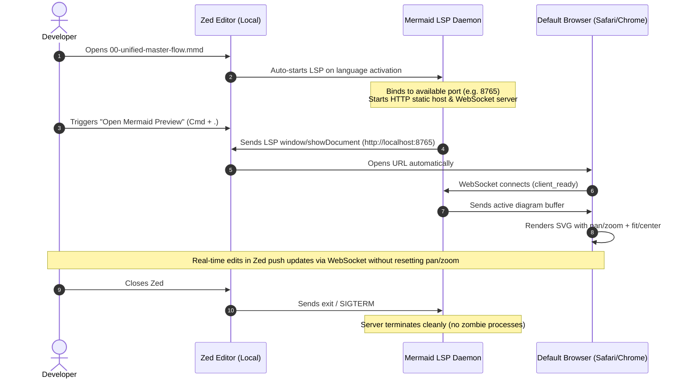

# Zed Mermaid Preview Extension: Specification & Feature-Driven Plan

## 1. Executive Summary & Goals

### Goal
Build a zero-configuration, high-fidelity Mermaid preview system for **Zed IDE** that:
1. **Provides 100% Diagram Fidelity:** Uses the official `mermaid.js` engine and WebKit/browser canvas (no partial reverse-engineered Rust parsers).
2. **Offers Interactive Navigation Controls:** Includes full pan, pinch-to-zoom, "Fit to Screen", "Center", "Reset 100%", theme matching, and SVG/PNG export.
3. **Requires Zero Configuration:** Starts silently in the background, grabs an open port automatically, launches the default browser via Zed LSP `window/showDocument`, and exits cleanly when Zed closes.
4. **Validates Syntax in Real Time:** Uses `mermaid.parse` to catch syntax errors and report them as diagnostics in Zed.
5. **Operates Local-First:** Designed and validated on macOS local first, while architecturally ready for remote SSH tunneling without code changes.

---

## 2. System Architecture & Flow

---

## 3. Feature-Driven Implementation Checklist

Instead of horizontal layers, this plan is structured into **vertical feature slices**. Each feature produces a testable, end-to-end capability.

### 🌟 Feature Slice 1: The Interactive Preview Canvas (Frontend)
- [x] **1.1 Single-bundle Webview Shell (`src/webview/index.html`)**
- [x] **1.2 Canvas Controls & Toolbar**
- [x] **1.3 Viewport State Lock (No Flash / Jump)**
- [x] **1.4 Syntax Error Overlay**

---

### 🌟 Feature Slice 2: The Zero-Config Live Daemon & Validator (Backend)
- [x] **2.1 Automatic Port Allocator**
- [x] **2.2 Static Asset & WebSocket Server (`src/server/index.js`)**
- [x] **2.3 Official Syntax Validation (`mermaid.parse`)**
- [x] **2.4 Clean Process Lifecycle**

---

### 🌟 Feature Slice 3: The Zed LSP Integration & Auto-Browser Launch
- [x] **3.1 LSP Protocol Handler (`src/lsp/index.js`)**
- [x] **3.2 In-Editor Diagnostics**
- [x] **3.3 The One-Click Preview Action**

---

### 🌟 Feature Slice 4: Zed Extension Packaging & Syntax Highlighting
- [x] **4.1 Manifest Definition (`extension.toml`)**
- [x] **4.2 Tree-sitter Grammar Integration**
- [x] **4.3 Local Development Installation**

---

### 🌟 Feature Slice 5: End-to-End Verification & Remote Parity
- [x] **5.1 Test with Complex Diagrams**
- [x] **5.2 Verify Non-Disruptive Editing**
- [x] **5.3 Verify Clean Shutdown**
- [x] **5.4 Remote Documentation**

---

## 4. Technical Specifications

| Component | Technology | Rationale |
| :--- | :--- | :--- |
| **Zed Extension Spec** | WebAssembly / Rust (`extension.toml`) | Standard Zed extension manifest format |
| **LSP Binary** | Node.js (Node v24 runtime already in system) | Runs `mermaid.js` official engine natively |
| **Webview Canvas** | Vanilla HTML5 / ES Modules | Minimal overhead, zero framework bloat |
| **Diagram Engine** | `mermaid@11.x` | Official engine with 100% chart & directive support |
| **Viewport Controller**| `svg-pan-zoom` | Industry-standard SVG pan, zoom, fit, and reset library |
| **Communication** | WebSocket (`ws`) + JSON-RPC (LSP) | Dual-channel: stdio for Zed LSP, ws for browser canvas |
